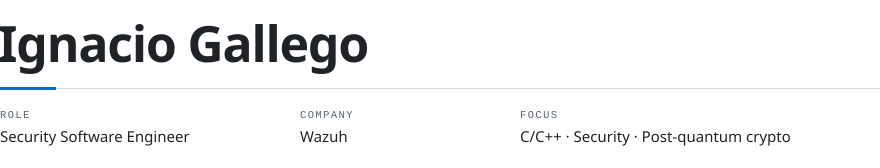

<picture>
  <source media="(prefers-color-scheme: dark)" srcset="assets/banner-dark.svg">
  
</picture>

I work on the server side of [Wazuh](https://github.com/wazuh/wazuh), an open source XDR and SIEM. Mostly C and C++ development, plus the Python framework behind its REST API: features, bug fixes and tests. Part of that work is security: memory safety and security fixes in the server.

On the side I work on post-quantum cryptography, which started with my thesis on HQC.

#### Work

- [**wazuh/wazuh**](https://github.com/wazuh/wazuh/pulls?q=author%3Aignaciogalle12git) · features, bug fixes, security patches and unit tests in the Wazuh server
- [**hqc-kem**](https://github.com/ignaciogalle12git/hqc-kem) · Python reference implementation of HQC-KEM, validated against the official NIST KAT vectors

#### Background

BSc in Computer Engineering, Universidad de Granada. [Thesis on HQC key encapsulation](https://lnkd.in/p/epdsZDs9).

#### Contact

[LinkedIn](https://www.linkedin.com/in/ignacio-gallego-ram%C3%B3n-9019ba374) · [ignaciogallepro@gmail.com](mailto:ignaciogallepro@gmail.com) · [@ignaciogalle12git](https://github.com/ignaciogalle12git)
